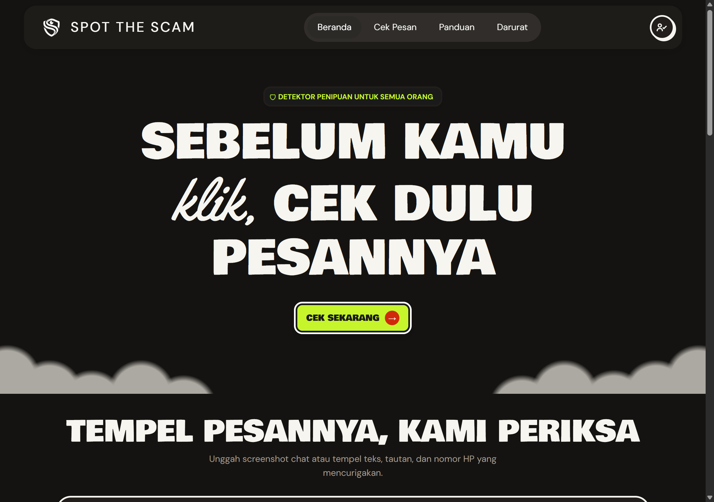
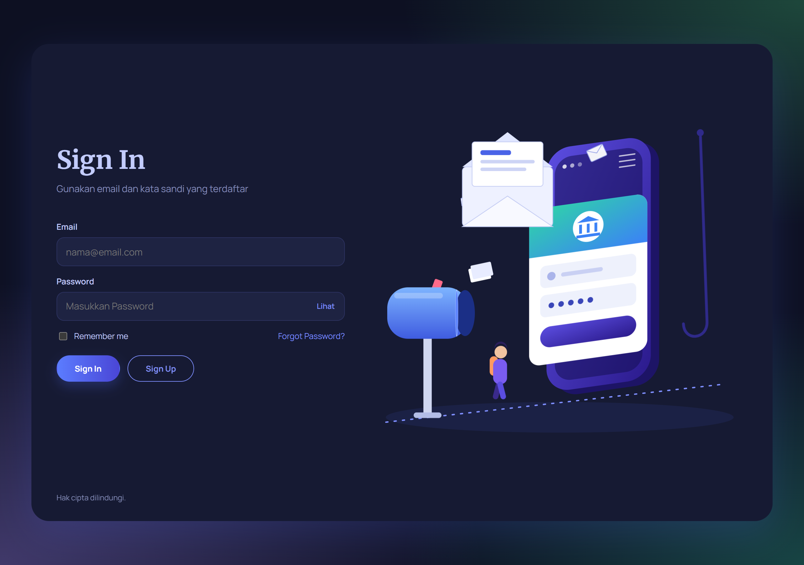
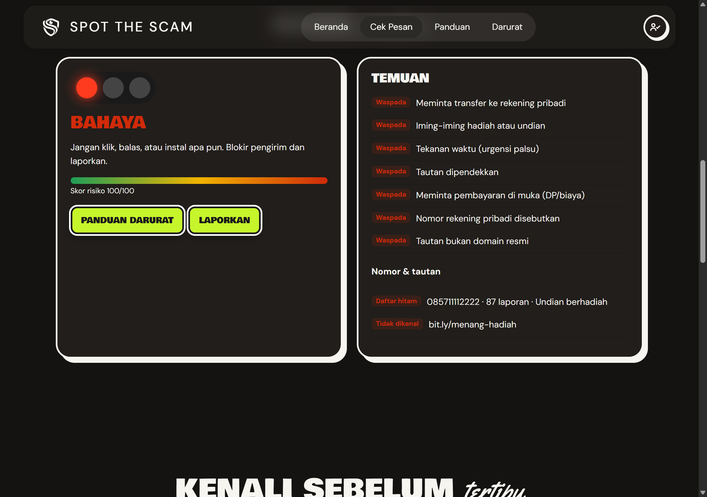
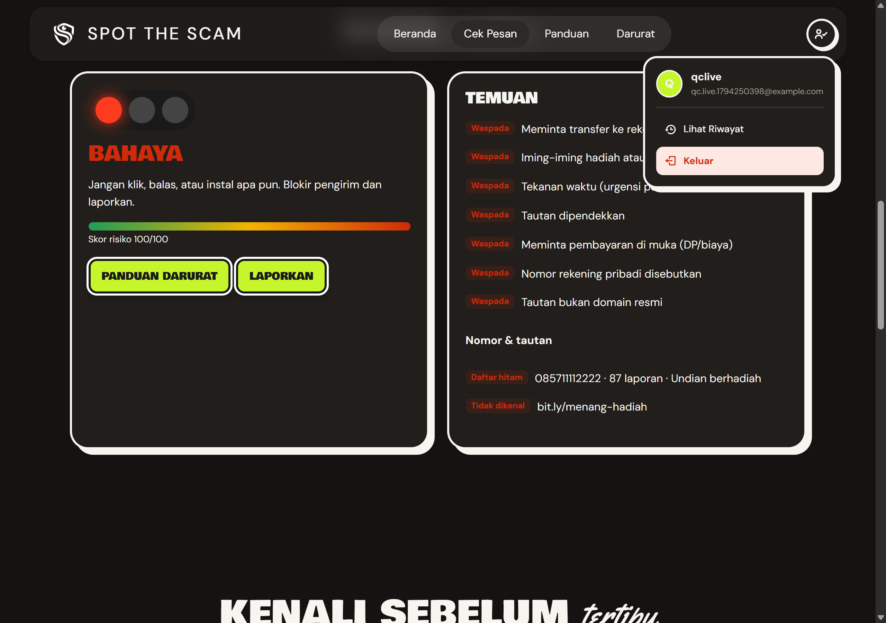

# 🕵️ Spot the Scam

**Cek pesan, tautan, nomor HP, atau screenshot yang mencurigakan — sebelum Anda membalas, mengklik, atau membayar.**

Tempel isi pesan atau unggah screenshot chat, lalu aplikasi memberi tahu tingkat risikonya dalam hitungan detik, lengkap dengan alasan dan langkah darurat.

[](https://lodraalbar.github.io/Spot-the-Scam-Cek-Pesan-Penipuan/)
[](https://github.com/Lodraalbar/Spot-the-Scam-Cek-Pesan-Penipuan)

- **Live Deployment:** <https://lodraalbar.github.io/Spot-the-Scam-Cek-Pesan-Penipuan/>
- **Video Demonstrasi:** _`<isi tautan video maks. 5 menit di sini>`_
- **Tema:** *Guardians of the Digital Space – Empowering Today's Generation Toward a Safer Cyber Ecosystem*
- **Kompetisi:** Web Development Competition MIT-Week 2026

---

## Tampilan aplikasi

| Beranda | Masuk / Daftar |
| --- | --- |
|  |  |

| Hasil analisis (BAHAYA) | Menu akun & riwayat |
| --- | --- |
|  |  |

---

## Daftar isi

1. [Latar belakang & kesesuaian studi kasus](#1-latar-belakang--kesesuaian-studi-kasus)
2. [Fitur utama](#2-fitur-utama)
3. [Petunjuk penggunaan](#3-petunjuk-penggunaan)
4. [Cara kerja deteksi & skor](#4-cara-kerja-deteksi--skor)
5. [Arsitektur & alur data](#5-arsitektur--alur-data)
6. [Menjalankan aplikasi](#6-menjalankan-aplikasi)
7. [Skema database](#7-skema-database)
8. [Struktur proyek](#8-struktur-proyek)
9. [Teknologi & atribusi pihak ketiga](#9-teknologi--atribusi-pihak-ketiga)
10. [Batasan & rencana pengembangan](#10-batasan--rencana-pengembangan)
11. [Tim](#11-tim)

---

## 1. Latar belakang & kesesuaian studi kasus

Penipuan digital menyasar kelompok paling rentan: orang tua, pelajar, dan pengguna baru internet. Modusnya berulang dan berpola — undian berhadiah, paket tertahan, permintaan OTP, transfer ke rekening pribadi, file `.apk` undangan, dan tautan pendek yang menyembunyikan alamat asli. Masalahnya, korban menghadapi pesan itu **sendirian, di bawah tekanan waktu**, tanpa alat bantu untuk memeriksanya.

Spot the Scam menjawab itu dengan empat prinsip:

| Permasalahan | Solusi di produk ini |
| --- | --- |
| Korban tidak tahu ciri pesan penipuan | Setiap analisis menampilkan **temuan konkret** ("Meminta kode OTP/PIN", "Tautan dipendekkan"), bukan sekadar vonis |
| Bukti penipuan sering berupa **screenshot**, bukan teks | Screenshot dibaca otomatis lewat OCR, pengguna tidak perlu mengetik ulang |
| Korban butuh tindakan, bukan teori | Hasil BAHAYA menyediakan **Panduan Darurat**, **Laporkan**, dan pencocokan nomor pelaku dengan daftar laporan |
| Pola penipuan berulang di banyak korban | Nomor pelaku dicocokkan ke daftar hitam berisi jumlah laporan; riwayat analisis tersimpan per akun |

## 2. Fitur utama

| Fitur | Deskripsi |
| --- | --- |
| **Analisis teks** | Tempel isi pesan; hasil keluar seketika: level (AMAN / MENCURIGAKAN / BAHAYA), skor 0–100, dan daftar temuan |
| **Analisis gambar (OCR)** | Tarik-lepas atau pilih screenshot (PNG/JPG, maks. 10 MB). Teks dibaca Tesseract.js (`ind+eng`) lalu dianalisis pada alur yang sama dengan input teks |
| **Pencocokan daftar hitam** | Nomor HP diekstrak (format `08…`, `62…`, `+62…`), dinormalisasi, lalu dicocokkan dengan daftar nomor terlapor beserta jumlah laporan |
| **Deteksi tautan** | Domain dibandingkan dengan daftar domain resmi (tokopedia.com, shopee.co.id, bca.co.id, bri.co.id, gojek.com); tautan pendek (`bit.ly`, `tinyurl`, `s.id`, `cutt.ly`) diberi bobot tersendiri |
| **Panduan darurat** | Langkah mitigasi instan saat hasil BAHAYA: jangan klik, blokir, amankan akun, laporkan |
| **Laporkan** | Tombol hanya muncul bila hasil analisis memuat nomor HP; laporan tersimpan ke database dengan status `pending` lalu muncul notifikasi tujuan laporannya |
| **Riwayat analisis** | Setiap pemeriksaan tersimpan per akun dan ditampilkan di `history.html` (waktu relatif, skor, isi pesan, status yang bisa diubah) |
| **Sinkron gambar ↔ teks** | Screenshot yang di-OCR mengisi kolom teks; bila teks dikosongkan, gambar ikut dilepas agar bisa uji ulang tanpa gambar |
| **Akun & sesi** | Daftar/masuk dengan Supabase Auth; halaman utama tidak dapat dibuka tanpa sesi aktif, halaman login otomatis dialihkan bila sudah masuk |
| **Lupa kata sandi** | Tautan pada form masuk membuka `reset-password.html`: minta tautan reset via email, buka tautannya, lalu set kata sandi baru; tautan kedaluwarsa ditangani dengan pesan yang jelas |
| **Antarmuka responsif** | Tata letak adaptif (5 breakpoint di halaman utama, 3 di halaman login), tema gelap berkontras tinggi, status hasil dibedakan warna **dan** teks |

**Akun demo:** `qc.live.1794250398@example.com` / `QcLive123!`
Pendaftaran akun baru juga terbuka (tanpa verifikasi email), jadi penguji dapat membuat akun sendiri dalam hitungan detik.

## 3. Petunjuk penggunaan

1. Buka <https://lodraalbar.github.io/Spot-the-Scam-Cek-Pesan-Penipuan/>.
2. **Daftar** (username min. 3 karakter, email valid, kata sandi min. 6 karakter). Setelah berhasil, formulir otomatis beralih ke mode **Sign In** — masukkan email dan kata sandi yang sama.
3. Di halaman **Cek Pesan**, tempel isi pesan pada kotak teks **atau** tarik screenshot chat ke area unggah.
4. Klik **Cek Sekarang** (atau tunggu OCR selesai — analisis berjalan otomatis setelah teks terbaca).
5. Baca kartu **Hasil**:
   - **AMAN** (skor 0) — tidak ada pola berbahaya yang terdeteksi.
   - **MENCURIGAKAN** (skor 1–79) — ada pola berisiko; verifikasi lewat kanal resmi sebelum bertindak.
   - **BAHAYA** (skor ≥ 80, ada pola bertanda bahaya, atau nomor terdaftar di daftar hitam) — jangan klik, balas, atau instal apa pun.
6. Buka panel **Temuan** untuk melihat alasan dan bagian **Nomor & tautan** untuk status daftar hitam, lalu gunakan **Panduan Darurat** atau **Laporkan**.
7. Riwayat: klik ikon akun di kanan atas → **Lihat Riwayat** (halaman `history.html`). Status tiap pemeriksaan bisa diubah antara *Dilaporkan* dan *Tidak Ditinjau*.

Contoh yang bisa langsung dicoba:

| Input | Hasil yang diharapkan |
| --- | --- |
| `Selamat! Undian berhadiah, klik bit.ly/xyz transfer ke rekening pribadi` | BAHAYA 100 — hadiah + tautan pendek + transfer rekening |
| `Pesanan Tokopedia #123 dikirim via JNE, cek tokopedia.com/lacak` | AMAN 0 — domain resmi, tanpa pola penipuan |
| `Kode OTP Anda 8891, jangan berikan ke siapa pun` | MENCURIGAKAN 40 — penyebutan OTP |
| `Kirim DP 500rb ke rekening BCA a.n Budi` | MENCURIGAKAN 60 — DP + nomor rekening |

## 4. Cara kerja deteksi & skor

Analisis berjalan sepenuhnya di browser. Setiap pola yang cocok menambah bobot; skor akhir dibatasi maksimum 100.

| Pola / temuan | Bobot | Catatan |
| --- | --- | --- |
| Meminta memasang file `.apk` | 100 | Penanda bahaya (langsung BAHAYA) |
| Meminta transfer ke rekening pribadi | 40 | |
| Meminta kode OTP / PIN / kode verifikasi | 40 | |
| Iming-iming hadiah / undian / "selamat" | 30 | |
| Tautan dipendekkan (`bit.ly`, `tinyurl`, `s.id`, `cutt.ly`) | 30 | |
| Meminta pembayaran di muka (DP, uang muka, biaya admin/kirim, pajak) | 30 | |
| Nomor rekening pribadi disebutkan | 30 | |
| Tekanan waktu ("segera", "24 jam", "hari ini juga", "terakhir") | 20 | |
| Tautan bukan domain resmi | 20 | Domain dicek terhadap daftar resmi |
| Nomor HP ada di daftar hitam | +100 | Sekaligus memaksa level BAHAYA |

**Ambang level:** BAHAYA bila ada nomor di daftar hitam, pola bertanda bahaya (`.apk`), atau skor ≥ 80; MENCURIGAKAN bila skor 1–79; AMAN bila skor 0.

Regex dirancang tahan terhadap teks hasil OCR multi-baris (memakai `[\s\S]{0,N}` alih-alih `.`), sehingga pola seperti "kirim DP" dan "nomor rekening" tetap terdeteksi meski terpisah baris.

## 5. Arsitektur & alur data

```
            ┌──────────────────────── Browser (client-side) ───────────────────────┐
Pengguna ──►│ login.html   signUp / signIn  ──► Supabase Auth (JWT)                │
            │     │                                                                │
            │     └─► home.html  ── guard: cek getSession() ──► redirect bila tamu │
            │             │                                                        │
            │             ├─ Input teks ──────────────────┐                        │
            │             └─ Screenshot ─► Tesseract.js ──┤ (OCR ind+eng)          │
            │                                            ▼                        │
            │                                   analyze() — 8 pola regex          │
            │                                   + cek domain resmi                 │
            │                                   + cek daftar hitam nomor           │
            │                                            ▼                        │
            │                              render() → level, skor, temuan         │
            └────────────────────────────────────────────┼─────────────────────────┘
                                                         ▼
                                   Supabase Postgres — RLS per pengguna
                                   analysis_history (riwayat) · reports (laporan)
```

- **Autentikasi** ditangani Supabase Auth; aplikasi tidak pernah menyimpan kata sandi. Registrasi memakai `supabase.auth.signUp()`, username disimpan pada `user_metadata`. Reset kata sandi memakai `resetPasswordForEmail()` dengan `redirectTo` ke `reset-password.html`; tautan email membawa `type=recovery`, halaman menampilkan form sandi baru lalu memanggil `updateUser({ password })` dan `signOut()` agar pengguna masuk ulang.
- **Proteksi rute** di sisi klien: dokumen disembunyikan (`visibility: hidden`) lalu sesi diperiksa hingga 15× dengan jeda 150 ms; tanpa sesi, pengguna dialihkan ke `login.html`. Halaman login melakukan pengecekan sebaliknya.
- **Sinkronisasi tabel `users`**: karena `analysis_history` dan `reports` mereferensikan `public.users(id)`, fungsi `ensureUserRow()` menyalin data pengguna Supabase Auth ke tabel tersebut (`upsert` + `ignoreDuplicates`) saat pertama kali dibutuhkan. `userReady()` melakukan percobaan ulang bila sesi belum pulih setelah reload — perbaikan atas bug riwayat kosong yang ditemukan saat pengujian.
- **Penyimpanan hasil** dilakukan sekali setelah analisis selesai (`saveAnalysisHistory()`), bukan di dalam `render()`, agar tidak ada baris ganda.
- **Kunci yang dipakai** hanya `anon key` (memang untuk klien). Seluruh tabel memakai RLS sehingga satu pengguna tidak dapat membaca data pengguna lain. `service_role` key tidak pernah ada di repositori.

## 6. Menjalankan aplikasi

Tidak ada proses build — cukup berkas statis.

**A. Menjalankan lokal**

```bash
git clone https://github.com/Lodraalbar/Spot-the-Scam-Cek-Pesan-Penipuan.git
cd Spot-the-Scam-Cek-Pesan-Penipuan
python -m http.server 8000
```

Buka <http://localhost:8000/lomba/login.html>. (Membuka `home.html` lewat `file://` juga bisa, tetapi server lokal lebih dekat dengan kondisi produksi: CDN, web worker OCR, dan penyimpanan sesi.)

**B. Menyiapkan backend Supabase sendiri**

1. Buat project di <https://supabase.com>.
2. Buka **SQL Editor**, jalankan seluruh isi [`setup.sql`](setup.sql). Berkas ini membuat tiga tabel, mengaktifkan RLS, dan memasang policy per pengguna.
3. Buka **Authentication → Sign In / Providers → Email**, matikan **Confirm email** agar pendaftaran langsung dapat dipakai.
4. Salin **Project URL** dan **anon public key** (Settings → API) ke `lomba/login.html`, `lomba/home.html`, dan `lomba/reset-password.html` — nilainya harus sama di ketiga berkas.
5. Buka **Authentication → URL Configuration**: isi **Site URL** dengan alamat situs, dan tambahkan `https://<domain-kamu>/lomba/reset-password.html` ke **Redirect URLs**. Tanpa ini, tautan reset kata sandi akan ditolak Supabase.
6. Jalankan ulang server, lalu daftar akun baru.

**C. Deploy**

Repo ini sudah dideploy sebagai situs statis. Untuk men-deploy ulang: push ke `main`, lalu **Settings → Pages → Source: Deploy from a branch → Branch `main`, folder `/`**. `index.html` di root berfungsi sebagai pengalih ke `lomba/login.html`. Vercel/Netlify dapat memakai repo yang sama tanpa konfigurasi tambahan (tanpa build command, output directory = root).

## 7. Skema database

| Tabel | Kolom | Keterangan |
| --- | --- | --- |
| `users` | `id` (PK, = `auth.users.id`), `email`, `username`, `created_at` | Cermin data akun agar tabel lain dapat memakai foreign key |
| `analysis_history` | `id`, `user_id` → `users.id`, `message`, `score`, `level`, `status` (default `unreviewed`), `flags` (JSONB), `created_at` | Satu baris per analisis |
| `reports` | `id`, `user_id` → `users.id`, `phone`, `url`, `description`, `status` (default `pending`), `created_at` | Laporan pengguna, dimoderasi manual |

RLS aktif pada ketiga tabel. Policy terpasang: pengguna hanya dapat `SELECT` barisnya sendiri, `INSERT` data pengguna/riwayat/laporan dengan `user_id` = `auth.uid()`, serta `UPDATE` status riwayatnya sendiri. Indeks `idx_history_user` dan `idx_reports_user` menjaga kueri riwayat tetap ringan.

## 8. Struktur proyek

```
.
├── index.html                     # Pengalih root → lomba/login.html (untuk hosting statis)
├── setup.sql                      # Skema tabel, RLS, dan index
├── docs/                          # Tangkapan layar untuk dokumentasi
├── lomba/
│   ├── login.html                 # Daftar & masuk (Supabase Auth)
│   ├── reset-password.html        # Lupa kata sandi: minta tautan + set sandi baru
│   ├── home.html                  # Analisis teks/gambar + OCR, laporan
│   ├── history.html               # Riwayat pemeriksaan + status per baris
│   └── logo.png
└── README.md
```

**Peta fungsi `home.html`** agar mudah ditelusuri saat pemeliharaan:

| Bagian | Fungsi / bagian penting |
| --- | --- |
| Data aturan | `DB.flags` (8 pola + bobot), `DB.blacklist`, `DB.official`, `DB.examples` |
| Mesin analisis | `analyze(text)` — ekstrak nomor & URL, hitung skor, tentukan level |
| Alur analisis | `runAnalysis()` — dipakai bersama oleh tombol **Cek Sekarang** dan hasil OCR |
| Input gambar | `readFile()` — validasi tipe/ukuran, OCR, lalu `runAnalysis()` |
| Tampilan | `render()` — kartu hasil, temuan, status nomor/tautan |
| Persistensi | `saveAnalysisHistory()`, `loadHistory()`, `saveReport()`, `ensureUserRow()`, `userReady()` |
| Sesi | `guard()` — penyembunyian dokumen + pengalihan ke halaman login |

## 9. Teknologi & atribusi pihak ketiga

| Komponen | Versi | Lisensi | Penggunaan |
| --- | --- | --- | --- |
| [Tesseract.js](https://github.com/naptha/tesseract.js) | 5.1.1 (CDN jsDelivr) | Apache-2.0 | OCR gambar di browser |
| Model bahasa Tesseract `ind` + `eng` | bawaan Tesseract.js CDN | Apache-2.0 | Pengenalan teks Bahasa Indonesia & Inggris |
| [supabase-js](https://github.com/supabase/supabase-js) | v2 (CDN jsDelivr) | MIT | Autentikasi & akses database |
| [Supabase](https://supabase.com) | — | — | Hosting Postgres + Auth (paket gratis) |
| [Google Fonts](https://fonts.google.com) — Bowlby One, DM Sans, Yellowtail | — | SIL Open Font License 1.1 | Tipografi antarmuka |
| [GitHub Pages](https://pages.github.com) | — | — | Hosting live deployment |

Seluruh kode aplikasi (HTML, CSS, JavaScript) ditulis sendiri tanpa framework maupun template pihak ketiga.

## 10. Batasan & rencana pengembangan

**Batasan saat ini**

- Analisis gambar berbasis **teks hasil OCR**, bukan analisis visual — screenshot buram perlu diketik ulang.
- Aturan deteksi bersifat *rule-based* dengan daftar hitam statis di sisi klien; belum ada model machine learning.
- Daftar nomor terlapor masih contoh (3 nomor) dan dimoderasi manual melalui Supabase Table Editor.
- Belum ada pembatasan laju (rate limit) pada form analisis.

**Rencana pengembangan**

- Memindahkan daftar hitam ke tabel database agar dapat diperbarui tanpa deploy ulang, plus endpoint pencarian nomor.
- Menambahkan analisis pratinjau tautan (redirect chain) di sisi server.
- Panel admin untuk moderasi laporan dan verifikasi nomor.
- Ekspor hasil analisis sebagai gambar agar mudah dibagikan ke keluarga.

## 11. Tim

| Nama | Peran |
| --- | --- |
| _`<nama ketua tim>`_ | Ketua, pengembangan antarmuka & analisis |
| _`<nama anggota>`_ | _`<peran>`_ |

**Kontak:** _`<email/WhatsApp>`_

---

Dibuat untuk **Web Development Competition MIT-Week 2026** — *Guardians of the Digital Space*.
